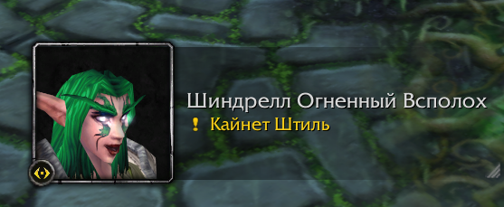

# Quest Voices RU

**Русская озвучка квестов для World of Warcraft Classic Era: персонажи сами зачитывают текст задания.**

Берёте квест — NPC рассказывает его голосом, сдаёте — благодарит. В комплекте 3902 квеста Азерота, 8720 реплик
и около 54 часов речи: озвучено 93% квестов с 1 по 60 уровень ([подробнее](#что-озвучено)). Это модуль
озвучки для аддона [VoiceOver](https://www.curseforge.com/wow/addons/voiceover): он нужен для работы, а со старым
русским паком VoiceOver звучат 98% квестов ([как это устроено](#как-это-устроено)).

[](https://github.com/ReSenpai/quest-voices-ru/releases/latest)
[](#совместимость)
[](LICENSE-ASSETS.txt)
[](LICENSE)



## Что умеет

- **Озвучка при взятии и сдаче квеста.** Реплика звучит, пока открыто окно задания; в углу экрана — портрет
  говорящего, как на картинке выше.
- **Голос под вашего персонажа.** Где NPC обращается к герою по-разному, играет реплика для мужского или женского
  персонажа.
- **Очередь и журнал.** Несколько реплик выстраиваются в очередь; задание можно прослушать заново из журнала квестов.
- **Голоса рас.** У ночных эльфов, дворфов, орков, тауренов и остальных — свои голоса.

## Послушать

Восемь квестов из стартовых зон — по одному на расу. Нажмите ▶ прямо на странице и включите звук 🔊 в плеере:
GitHub запускает видео без звука, по-другому он не умеет.

**Ночной эльф** — «Природное равновесие». Опекун Илталайн, Тенистая долина.

https://github.com/user-attachments/assets/322d46dd-b4a6-4e74-88f8-50bd6ee3bba5

**Человек** — «Нападение на лагерь кобольдов». Маршал Макбрайд, Долина Североземья.

https://github.com/user-attachments/assets/2bf1fbea-80df-48d4-85fc-0bc35e7d72ce

**Дворф** — «Охотник на вепрей». Талин Остроглаз, Долина Холодного Ручья.

https://github.com/user-attachments/assets/090f906c-fa54-41c3-8ef7-49c608629ac6

**Гном** — «Битва под землей». Шони Молшунья, Штормград.

https://github.com/user-attachments/assets/cb338553-fa19-49d2-8e43-50c4888ea107

**Орк** — «Кабаньи клыки». Горнек, Долина Испытаний.

https://github.com/user-attachments/assets/ca5353cc-e6e8-44cd-b225-e817852857f9

**Тролль** — «Саркот». Хана'зуа, Долина Испытаний.

https://github.com/user-attachments/assets/73ae5110-7dd9-416f-9319-c1b95d14e047

**Таурен** — «Охота продолжается». Грулл Соколиный Ветер, Красное Облако.

https://github.com/user-attachments/assets/236bb9d8-afb3-4daa-aebf-5780606129e3

**Нежить** — «Резкое пробуждение». Мордо гробовщик, Похоронный Звон.

https://github.com/user-attachments/assets/5338fb18-dbb2-452b-a945-00b811f0f651

Те же примеры файлами — в [docs/samples](docs/samples): если открыть файл (View raw), звук не приглушён.

## Что озвучено

Квесты с 1 по 50 уровень — почти все, 51–60 — почти девять из десяти.

| Уровень квеста | Озвучено | Всего квестов | Доля |
| --- | ---: | ---: | ---: |
| 1–10 | 453 | 456 | 99% |
| 11–20 | 468 | 481 | 97% |
| 21–30 | 428 | 448 | 96% |
| 31–40 | 447 | 461 | 97% |
| 41–50 | 464 | 477 | 97% |
| 51–60 | 1642 | 1863 | 88% |
| **Всего** | **3902** | **4186** | **93%** |

«Всего квестов» — квесты Classic Era с русским текстом взятия или сдачи (по базе vmangos), уровень — уровень
квеста. Часть оставшихся реплик ещё ждёт прослушивания — их добавим в следующих версиях.

## Как это устроено

Озвучку в игре проигрывает аддон **VoiceOver**: окно с портретом, очередь, журнал. Сам он звука не содержит — звук
лежит в **модулях озвучки**, которые VoiceOver находит сам. Quest Voices RU — один такой модуль. Можно поставить
несколько: на каждую реплику VoiceOver берёт модуль с наибольшим приоритетом, у которого она есть.

| Что | Нужно? | Зачем |
| --- | --- | --- |
| [VoiceOver](https://www.curseforge.com/wow/addons/voiceover) 1.4.5 или новее | **обязательно** | плеер: без него модуль молчит |
| **Quest Voices RU** (этот аддон) | да | основная озвучка, приоритет 200 |
| [Русский пак VoiceOver для классики](https://github.com/the-homeless-god/wow-voiceover/releases/tag/v1.2.0) | по желанию | запасной: озвучивает то, чего нет здесь, приоритет 100 |

Как VoiceOver выбирает голос для реплики:

1. Есть в Quest Voices RU — играет она (для мужского или женского персонажа, если у реплики два варианта).
2. Нет — играет русский пак VoiceOver, если он установлен.
3. Нет нигде — тишина.

Выбор идёт по каждой реплике отдельно, поэтому в одном квесте голоса могут смениться: взятие — голосом Quest Voices
RU, сдача — голосом старого пака. Приветствия NPC при разговоре (без квеста) в Quest Voices RU не озвучены — их
играет русский пак.

С запасным паком квестов звучит заметно больше:

| Уровень квеста | Quest Voices RU | Добавляет русский пак | Без голоса | Звучит вместе |
| --- | ---: | ---: | ---: | ---: |
| 1–50 | 2260 | 50 | 13 | 99% |
| 51–60 | 1642 | 144 | 77 | 96% |
| **Всего** | **3902** | **194** | **90** | **98%** |

## Установка

1. **VoiceOver.** В приложении CurseForge найдите VoiceOver (автор MrThinger) и установите. Или вручную: скачайте
   `AI_VoiceOver-WoW_BlizzClassic-v1.4.5.zip` из [релиза VoiceOver](https://github.com/mrthinger/wow-voiceover/releases/tag/v1.4.5)
   и распакуйте в `World of Warcraft\_classic_era_\Interface\AddOns` — получится папка `AI_VoiceOver`.
   Нужна версия 1.4.5 или новее: старые не работают на клиенте 1.15.9.
2. **Quest Voices RU.** Скачайте `quest-voices-ru-v<версия>.zip` из
   [последнего релиза](https://github.com/ReSenpai/quest-voices-ru/releases/latest) и распакуйте туда же — получится
   папка `AI_VoiceOverData_QuestVoices_RU`.
3. **Русский пак VoiceOver (по желанию).** Скачайте `AI_VoiceOverData_Vanilla-RU.zip` из
   [его релиза](https://github.com/the-homeless-god/wow-voiceover/releases/tag/v1.2.0) (около 1 ГБ) и распакуйте туда
   же. В архиве папка называется `AI_VoiceOverData_Vanilla_OGG` — **переименуйте её в `AI_VoiceOverData_Vanilla`**,
   иначе игра её не увидит. Если клиент пометит его устаревшим, включите «Загружать устаревшие модификации».
4. Запустите игру заново — именно перезапуск, а не `/reload`: так клиент увидит новые звуки.

В итоге в `Interface\AddOns` должно быть:

```
AI_VoiceOver                       — VoiceOver, плеер
AI_VoiceOverData_QuestVoices_RU    — Quest Voices RU
AI_VoiceOverData_Vanilla           — русский пак VoiceOver (если поставили)
```

Не путайте русский пак с английским «VoiceOver Data - Vanilla»: папка у него та же, но речь английская.
Не включайте одновременно аддон CatQuest с его озвучкой — квесты зазвучат дважды.

### Удаление

Закройте игру и удалите папку `AI_VoiceOverData_QuestVoices_RU`. Галочки в списке аддонов мало: VoiceOver загружает
модули озвучки, даже если они выключены. Остальное (VoiceOver, русский пак) продолжит работать как раньше.

## Совместимость

- **Клиент:** World of Warcraft Classic Era 1.15, русский (ruRU). Проверено на 1.15.9.
- **Другие языки клиента:** модуль озвучки не включается — русская речь не зазвучит поверх чужого текста.
- **VoiceOver:** 1.4.5 или новее (проверено на 1.4.5).
- **Что не озвучено:** 7% квестов ([таблица](#что-озвучено)): реплики, которых нет в CatQuest Voices, и реплики,
  которые ещё не прослушаны или отличаются от текста задания в игре. Их может сыграть русский пак VoiceOver ([как это устроено](#как-это-устроено)).

## Авторы

Quest Voices RU собрана на основе двух чужих проектов — без них её бы не было:

- **[VoiceOver](https://github.com/mrthinger/wow-voiceover)** — mrthinger, xvwyh и
  [соавторы](https://github.com/mrthinger/wow-voiceover/graphs/contributors). Плеер озвучки: окно с портретом,
  очередь, журнал. Quest Voices RU — модуль для него; сам плеер ставится отдельно (Unlicense).
- **[CatQuest Voices](https://www.curseforge.com/wow/addons/catquest-voices)** — Cathey (daniilcathey).
  Вся русская озвучка квестов. Использована версия 0.7.1 под лицензией
  [CC BY-NC-SA 4.0](https://creativecommons.org/licenses/by-nc-sa/4.0/); звук не изменён — поменялись только имена
  файлов и индексы, чтобы его мог проигрывать VoiceOver.

Запасной русский пак VoiceOver для классики — Marat Zimnurov
([the-homeless-god/wow-voiceover](https://github.com/the-homeless-god/wow-voiceover)), отдельный проект; в Quest Voices
RU он не входит.

Сборка — [ReSenpai](https://github.com/ReSenpai). Модуль собран конвертером, сделанным на основе
[русского VoiceOver](https://github.com/the-homeless-god/wow-voiceover) — Marat Zimnurov (the-homeless-god) и Proza1k,
GPL v3; тот, в свою очередь, основан на [VoiceOver](https://github.com/mrthinger/wow-voiceover) mrthinger (Unlicense).

Это неофициальная сборка: авторы VoiceOver, русского VoiceOver и CatQuest Voices в ней не участвуют и не одобряли её.
Об ошибках пишите в [issues](https://github.com/ReSenpai/quest-voices-ru/issues) этого репозитория.

## Лицензия

- Озвучка, её таблицы и примеры — **CC BY-NC-SA 4.0** ([LICENSE-ASSETS.txt](LICENSE-ASSETS.txt)): бесплатно, с
  указанием авторов, производные — на тех же условиях. Продавать, ставить за рекламу или в программы вознаграждений
  нельзя.
- Код сборки — **GNU GPL v3** ([LICENSE](LICENSE)). Сторонние части — в [THIRD-PARTY.md](THIRD-PARTY.md).

Подробно — в [NOTICE](NOTICE). World of Warcraft — товарный знак Blizzard Entertainment, Inc.; проект с Blizzard не
связан.
